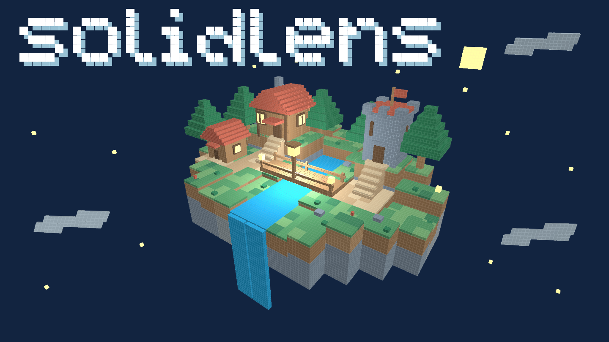
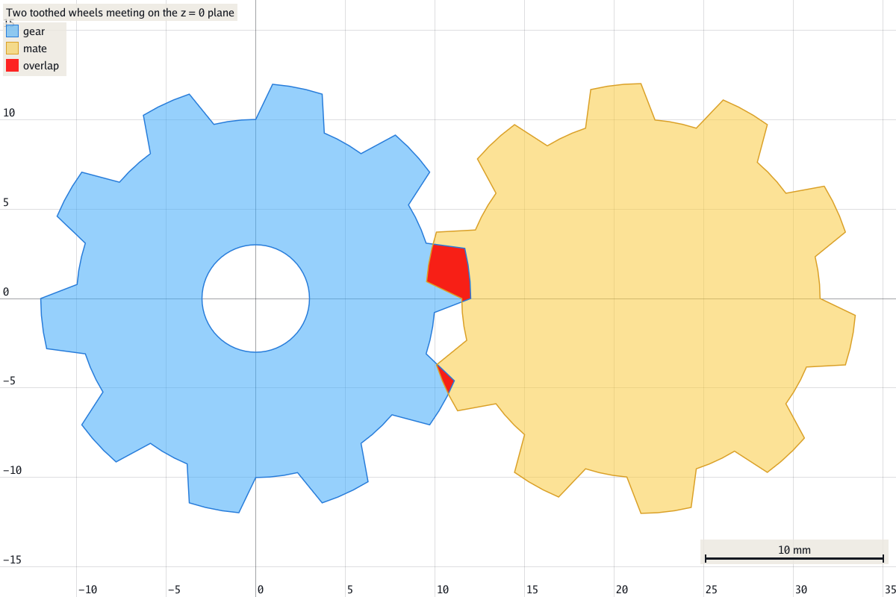
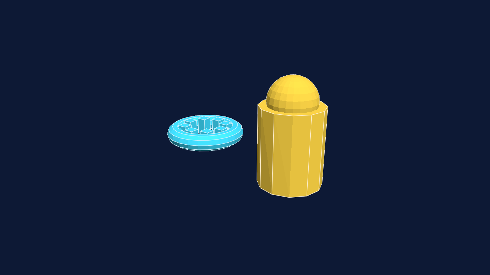
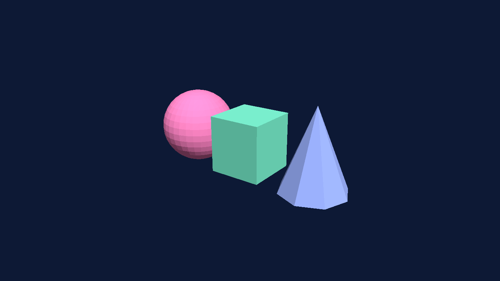

# solidlens

<p align="center">
  
</p>

`solidlens` is a pure-Go, headless raster renderer for triangle meshes. It
loads STL, 3MF, and OBJ files, accepts `*decad.Mesh` through `TriangleSource`,
and renders a configured scene to an `image.RGBA` or PNG stream.

The scene owns the camera, model materials, directional and point lights, and
background. The renderer owns only output dimensions, so it is safe to call
concurrently with independent scenes.

## Install

```text
go get github.com/lestrrat-3d/solidlens
```

## API

Use `ReadMesh` when the filename selects the import format, or call
`ReadSTL`, `Read3MF`, or `ReadOBJ` directly. `Read3MF` uses
`github.com/lestrrat-go/3mf`, including build transforms, components, and
model units. `ReadSTL` uses `github.com/lestrrat-go/stl`.

Use `MeshFrom` for native geometry. `*decad.Mesh` satisfies `TriangleSource`
without an adapter because it provides `Vertices() []r3.Vec` and
`Triangles() [][3]int`.

Build a `Scene` with `Camera`, `Model`, `Material`, `DirectionalLight`,
`PointLight`, and `Background`, then call `Render` or `RenderPNG`. Mesh
coordinates are treated as millimetres.

Set `Model.Edges` to draw lines along a model's edges. `Edges` carries
`Enabled`, `Color`, and a `Width` in pixels, and it is off by default.
`Outline` fills in the usual values for a given color. An edge is drawn when
it borders the mesh, when the two faces meeting there differ by at least
`CreaseAngle` degrees, or when it lies on the model's silhouette, so a
tessellated curve keeps its outline without turning into a grid of facets. A
negative `CreaseAngle` draws every shared edge, which gives a full wireframe.
A facet narrower than half a pixel at the model's distance does not turn its
neighbours' shared edge into a crease, so the gaps and slivers a CAD kernel
leaves between smooth faces draw no line. A face built from many such facets,
such as a flat flank cut into long needles, is wider than half a pixel as a
whole, so it keeps its own creases. Set `Edges.Tolerance` to a length in
millimetres to change that width, or to `solidlens.Exact` to draw the mesh as it
is.

Edges are drawn after every model's surface, so they stay hidden behind
nearer bodies.

Open meshes render with both sides lit. A decad sheet body, the result of
`WithSurfaceResult`, tessellates to such a mesh, and passing its `*decad.Mesh`
as `Model.Mesh` shows its inner walls as well as its outer ones. The front of
a triangle is the side its vertices wind counter-clockwise on, which for a
sheet is decad's positive side. Set `Model.BackMaterial` to shade the other
side in a different material and make the sheet's orientation visible. When
it is nil, both sides use `Model.Material`. Edge lines are drawn along a
sheet's free edges, because those edges border the mesh.

The [examples](examples) package contains a tested end-to-end render.

## Plane sections

`RenderSection` draws how two or more solids meet on a cutting plane. Give a
`SectionView` the plane (`Origin`, and orthonormal in-plane axes `U` and `V`,
so a point's plane coordinates are `(p-Origin).U` and `(p-Origin).V`) and one
`SectionLayer` per solid. A layer holds closed loops of 3D points that lie in
the plane, such as decad's `Body.SectionOutline` returns: outer loops run
counter-clockwise seen from the tip of `U x V`, and holes run clockwise.

```go
img, report, err := solidlens.RenderSection(ctx, solidlens.SectionView{
	Plane: solidlens.SectionPlane{U: solidlens.Vec{X: 1}, V: solidlens.Vec{Y: 1}},
	Layers: []solidlens.SectionLayer{
		{Name: "gear", Loops: gearLoops, Fill: solidlens.RGBA(0.05, 0.4, 0.95, 0.55), Outline: solidlens.RGB(0.02, 0.2, 0.7)},
		{Name: "mate", Loops: mateLoops, Fill: solidlens.RGBA(0.95, 0.6, 0.05, 0.55), Outline: solidlens.RGB(0.7, 0.35, 0.02)},
	},
})
```

Where two layers cover the same area the overlap color, red by default, paints
over both, and edges are anti-aliased by supersampling. The image gets a
millimetre grid with labels, a scale bar, a legend, and an optional `Caption`.
The window fits all layers unless `Window` is set. The returned
`SectionReport` has each layer's exact area, a raster estimate of it, and the
raster overlap area, along with the pixel and sample sizes that bound the
estimate's precision.



## Gallery

The gallery uses triangle meshes built in Go and rendered with `RenderPNG`.
It shows directional and point lighting, per-model materials, edge lines,
perspective camera placement, and a configured background. The faceted bodies
show their facet edges, while the sphere keeps only its silhouette, because
its neighbouring faces stay under the default crease angle.

| Mechanical forms | Primitive forms |
|---|---|
|  |  |

The committed STL and 3MF files in [`docs/models`](docs/models) are the scene
sources. Run `go run ./internal/cmd/genimages` to regenerate the checked-in
images from those files and the section image from its in-code outlines. Run `go run ./internal/cmd/genimages --models` only
when intentionally rebuilding the model assets.

## License

This project is **source-available**, and is licensed under the
[PolyForm Noncommercial License 1.0.0](LICENSE).

* **Noncommercial use is free.** Individuals, hobby and personal projects,
  research, education, nonprofits, and government may use, modify, and
  redistribute it at no cost, subject to the license terms.
* **Commercial / business use requires a separate license.** Any use by or for
  a business, or for commercial advantage, is not permitted under the
  noncommercial license. To obtain a commercial license, reach out on Bluesky
  at [@lestrrat.bsky.social](https://bsky.app/profile/lestrrat.bsky.social).

### Contributions

This repository does **not** accept external pull requests.
